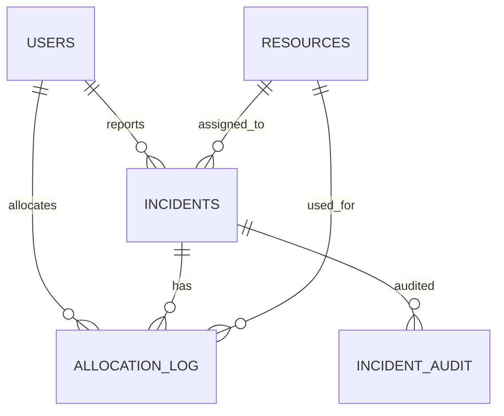

# Project Documentation — SMART Emergency System Allocation System

## Problem statement
Emergency teams can struggle to coordinate incident reports and identify available response resources quickly. This project demonstrates a database-backed dashboard to record reports, prioritize them, and allocate available resources by incident type and capacity.

## Objectives
1. Register and track incidents with severity, location, and number of people affected.
2. Display a priority-ordered queue and searchable status filters.
3. Maintain resource capacity and current availability.
4. Allocate matching resources transactionally and record each allocation.
5. Demonstrate relational database design and advanced SQL operations.

## Scope
This is a coursework prototype using manually entered incident data and seeded sample resources. It does not contact emergency services, use GPS, or make real-world dispatch decisions.

## Functional requirements
- User registration/login with Admin and Staff roles.
- Incident reporting and validation.
- Search/filter incident list and update status.
- List resource availability.
- Allocate an available matching resource.
- Record allocation history and audit status/severity changes.

## Database choice
MySQL stores structured users, incidents, response resources, allocations and audit events. These entities need relational integrity, constraints, joins and transactions. Redis stores append-only incident lifecycle events in an `incident_events` collection. The flexible event documents capture event type, incident/resource references, event metadata and timestamps. Compound indexes support incident timeline and event-type queries.

## Relational schema
- `users(id PK, name, email UNIQUE, password_hash, role, created_at)`
- `resources(id PK, name UNIQUE, resource_type, capacity, available_units, location, status, created_at)`
- `incidents(id PK, ..., reported_by FK -> users.id, assigned_resource_id FK -> resources.id)`
- `allocation_log(id PK, incident_id FK, resource_id FK, allocated_by FK, allocated_at, notes)`
- `incident_audit(id PK, incident_id FK, old_status, new_status, old_severity, new_severity, changed_at)`

## ER diagram (Mermaid)

## Architecture
Browser (Next.js React UI) → Next.js route handlers → MySQL pool → relational tables/views/triggers/procedure; incident lifecycle events are also written to Redis `incident_events`. Passwords are bcrypt-hashed; the session cookie is HTTP-only and HMAC-signed.

## Important queries
See `sql/schema.sql` for active priority queue, availability aggregation, allocation history joins, severity counts and a subquery. See `sql/advanced_features.sql` for stored procedure.

## Testing checklist
1. Register a user with valid data; ensure password is stored as a hash.
2. Try duplicate email; expect a conflict response.
3. Sign in with a wrong password; expect 401.
4. Create an incident with valid fields; expect 201.
5. Try invalid severity or zero people affected; expect 400.
6. Allocate a Medical incident; it should use an available Ambulance.
7. Attempt allocation twice; second attempt should be rejected.
8. Resolve an incident and confirm it is removed from active view.
9. Change severity/status and confirm audit trigger logs it.
10. Confirm the resource's available unit count decrements after allocation.

## Future enhancements
Add Redis for unstructured responder notes/event stream; map-based distance scoring; notification service; role-restricted admin controls; analytics; automated test suite and deployment hardening.
